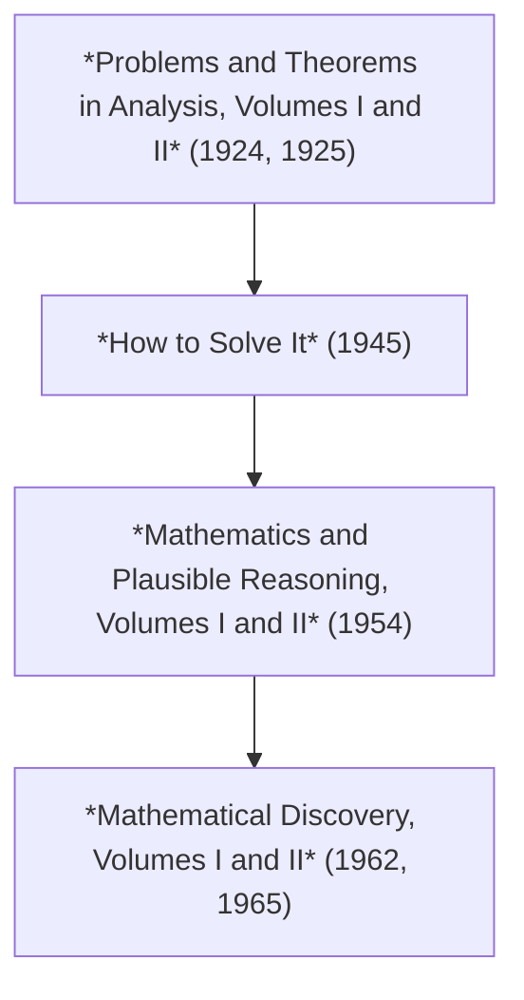

import BibRef from '@site/src/components/BibRef';
import Asterisk from '@site/src/components/Asterisk';

This post highlights a variety of reflection-worthy excerpts from Georga Polya on problem solving.

<!--truncate-->

If you enjoy solving problems or are interested in the field of problem solving in general, then there's a decent chance you've come across Georga Polya's renowned book *How to Solve It*, a book frequently known and referenced for proposing four phases to describe a general framework for an ostensibly fruitful problem-solving process: 

- understand the problem
- devise a plan
- carry out the plan
- look back

Polya spends the majority of his book outlining details or "heuristics" for effectively implementing this process, details which are worth reading in full. It's also worth reading the foreword to the book by [John Conway](https://en.wikipedia.org/wiki/John_Horton_Conway), a few short pages included with most modern printings of the book.

Conway opens his foreword by noting the personal and historical significance of *How to Solve It*. He appeals to a description by [A. H. Schoenfeld](https://en.wikipedia.org/wiki/Alan_H._Schoenfeld) to underscore the book's importance: "For mathematics education and the world of problem solving it marked a line of demarcation between two eras, problem solving before and after Polya." This description comes from Schoenfeld's article in *Mathematics Magazine* titled [*Polya, Problem Solving, and Education*](https://www.researchgate.net/publication/264913424_Polya_Problem_Solving_and_Education). Unsurprisingly, Schoenfeld's article is worth reading. It provides a great deal of insight into Polya's work. It also effectively captures the context within which *How to Solve It* was written: "The combined volumes on those topics [the structure of mathematics and the nature of mathematical discovery] &#8212; the two problem books co-authored with Szego, *How to Solve It*, the two volumes of *Mathematics and Plausible Reasoning*, and the two volumes of *Mathematical Discovery* [volumes are listed chronologically] &#8212; comprise a collection of extraordinary scope and power."

Reading the beginnings of these volumes is both instructive and inspiring, as Polya does an excellent job fleshing out the philosophical underpinnings of each work in its first few pages. My goal for this post is to simply highlight some excerpts I found to be especially worthy of observation and/or reflection. Each highlighted reference, when hovered over, reveals details like the page number from which the excerpt was taken as well as any personal commentary I may have on the excerpt itself (e.g., <BibRef id='GP2014' pages='pp. 28-31'>Personal commentary on the excerpt that may or may not be of use to the reader!</BibRef>). My hope in relegating my personal commentary to "hover notes" is that readers can reference this page and enjoy the excerpts without being visibly confronted with my possibly unhelpful personal annotations. Nonetheless, for those interested, I have recorded a few [personal takeaways](#personal-takeaways) at the end of this page.

Excerpts appear from the following works:

- *Polya, Problem Solving, and Education* <BibRef id='AHS1987' pages=''></BibRef>
- *Problems and Theorems in Analysis I* <BibRef id='GP1972' pages=''></BibRef>
- *Problems and Theorems in Analysis II* <BibRef id='GP1976' pages=''></BibRef>
- *How to Solve It* <BibRef id='GP2014' pages=''></BibRef>
- *Mathematics and Plausible Reasoning - Induction and Analogy in Mathematics (Volume 1)* <BibRef id='GP1954Vol1' pages=''></BibRef>
- *Mathematics and Plausible Reasoning - Patterns of Plausible Inference (Volume 2)* <BibRef id='GP1954Vol2' pages=''></BibRef>
- *Mathematical Discovery - On understanding, learning, and teaching problem solving (Volume 1)* <BibRef id='GP1962' pages=''></BibRef>
- *Mathematical Discovery - On understanding, learning, and teaching problem solving (Volume 2)* <BibRef id='GP1965' pages=''></BibRef>

And the timeline for these works (Schoenfeld's article was published in 1987):

## Polya, Problem Solving, and Education

> *How to Solve It* marked a turning point both for its author and for problem solving. For Polya it was the first of a series of major volumes on the nature of mathematical thinking, the topic that became the focus of his work in his later years. *How to Solve It* was followed in 1954 by the two volumes of *Mathematics and Plausible Reasoning*, and in 1962 and 1965 by the two volumes of *Mathematical Discovery*. <BibRef id='AHS1987' pages='p. 283'><em>How to Solve It</em> was published in 1945.</BibRef>

> For mathematics education and for the world of problem solving it marked a line of demarcation between two eras, problem solving before and after Polya. <BibRef id='AHS1987' pages='p. 283'></BibRef>

> What is good education? Giving systematically opportunity to the student to discover things by himself. <BibRef id='AHS1987' pages='p. 283'>This appears at the beginning of the epigraph to the first volume in Polya's two-volume problem books on analysis, followed by a parenthetical note: "(Condensed from H. Spencer)," the H. Spencer in question being [Herbert Spencer](https://en.wikipedia.org/wiki/Herbert_Spencer), the controversial English philosopher and social theorist. "Condensed" is doing some heavy lifting here, as the statement in Polya's work is not a direct quote of Spencer, rather an attempted paraphrasing or summary of Spencer's views on education.</BibRef>

> His was the study of *heuristic*. "The aim of heuristic is to study the methods and rules of discovery and invention... Heuristic, as an adjective, means 'serving to discover.' Heuristic reasoning is reasoning not regarded as final and strict but as provisional and plausible only, whose purpose is to discover the solution of the present problem." <BibRef id='AHS1987' pages='p. 284'>The quote Schoenfeld provides here is from *How to Solve It* (pp. 112-113).</BibRef>

> *How to Solve It* provides the general outline of a problem solving framework and a hint of the details necessary to implement it. The general framework offers a four-phase description of the problem-solving process: understanding the problem, devising a plan, carrying out the plan, looking back. The details are Polya's heuristic suggestions, or as he calls them, his modern heuristic. Heuristic strategies are rules of thumb for making progress on difficult problems. There are, for example, heuristic strategies for understanding a problem (focusing on the unknown, on the data, drawing a diagram, etc.), for devising a plan (exploiting related problems, analogous problems, working backwards, etc.), and for carrying out and checking a solution. The "short dictionary of heuristic," an alphabetical compendium of techniques and historical notes comprising the bulk of *How to Solve It*, provides some elaboration. <BibRef id='AHS1987' pages='p. 284'>It seems to be very common for people to have heard of the four phases Polya put forward but not the evidence that supports them (i.e., the heuristics).</BibRef>

> We find them [Polya's major philosophical and pedagogical claims] summed up as follows: "Mathematical facts are first guessed and then proved, and almost every passage in this book endeavors to show that such is the normal procedure. If the learning of mathematics has anything to do with the discovery of mathematics, the student must be given some opportunity to do problems in which he first guesses and then proves some mathematical fact on an appropriate level." <BibRef id='AHS1987' pages='p. 286'>Schoenfeld quotes the first volume of Polya's *Mathematics and Plausible Reasoning* (p. 160)</BibRef>

> On the philosophical plane Polya was formulating an empiricist view of mathematics, one that treats mathematics as a discipline of discovery on a par with the natural sciences. Despite the fact that it may appear so from the outside, Polya argued, mathematics is not a purely deductive science that starts with a few axioms and builds up irrevocably from those. "To a philosopher with a somewhat open mind all intelligent acquisition of knowledge should appear sometimes as a guessing game... The result of the mathematician's creative work is demonstrative reasoning, a proof, but the proof is discovered by plausible reasoning, by guessing." <BibRef id='AHS1987' pages='p. 158'>Schoenfeld quotes the first volume of Polya's *Mathematics and Plausible Reasoning* (p. 158)</BibRef>

> In *Proofs and Refutations*, one of the most charming mathematics and philosophy books ever written, Lakatos [the author and a joint student of Polya and [Karl Popper](https://en.wikipedia.org/wiki/Karl_Popper)] pursued the history of the development of [Euler's formula](https://en.wikipedia.org/wiki/Euler_characteristic). His historical treatment shows that basic definitions (like the definition of "polyhedron") are changed by mathematicians when they need to, in the light of new empirical evidence &#8212; for example, when a theorem everybody knows ought to be true turns out to be false. In that way, mathematics responds to "data" just as empirical science does. Definitions are revised by mathematicians in the same way that theories are revised by physical scientists. <BibRef id='AHS1987' pages='p. 286'></BibRef>

> As with Polya's earlier books, the text [in his two-volume book *Mathematical Discovery*] follows the logic of the subject matter, placing the burden of inquiry on the student; the student learns by working sequences of "interesting and worthwhile problems." And as with Polya's other books, the student who manages to work all the problems has done a fair amount of honest-to-goodness mathematics. *Mathematical Discovery* offers a wealth of problems from straightedge and compass geometric constructions, to algebra, recursion, and applications of superposition. Students who work those problems will have learned some important techniques in a way that gets to the structure of the underlying mathematics and that cuts through the standard topical presentations. The books also offer theoretical descriptions of the problem-solving process, supplemented with exercises so that students "live" the mathematics rather than just reading about it. In short, *Mathematical Discovery* is a classic. <BibRef id='AHS1987' pages='p. 286'>Polya remarks on this elsewhere, but it should be noted that *extensive care* went into the selection of the "interesting and worthwhile problems." As Schoenfeld notes, Polya's goal was clearly not topical coverage. He carefully brought different topics to life by illuminating their underlying mathematical structure as well as motivating the possible plausible resoning used in their discovery.</BibRef>

> It [*Mathematical Discovery*] represents the capstone of Polya's career, returning to the themes he explored throughout that career: the structure of mathematics and the nature of mathematical discovery. The combined volumes on those topics &#8212; the two problem books co-authored with Szego, *How to Solve It*, the two volumes of *Mathematics and Plausible Reasoning*, and the two volumes of *Mathematical Discovery* &#8212; comprise a collection of extraordinary scope and power. <BibRef id='AHS1987' pages='p. 287'></BibRef>

> Excited by my readings in the early 1970s, I sought out some problem-solving experts, mathematics faculty who coached students for the Putnam exam or for various Olympiads. Their verdict was unanimous and unequivocal: Polya was of no use for budding young problem-solvers. Students don't learn to solve problems by reading Polya's books, they said. In their experience, students learned to solve problems by (starting with raw talent and) solving lots of problems. The mathematics education literature was no more encouraging. Largely because Polya's ideas seemed so right, the math-ed literature was chock full of studies designed to teach problem solving *via* heuristics. Unfortunately, the results &#8212; whether in first grade, algebra, calculus, or number theory, to name a few &#8212; were all depressingly the same, and served to confirm the statements of the Putnam and Olympiad trainers. Study after study produced "promising" results, where teacher and students alike were happy with the instruction (a typical phenomenon when teachers have a vested interest in a new program), but where there was at best marginal evidence (if any!) of improved problem-solving performance. Despite all the enthusiasm for the approach, there was no clear evidence that the students had actually learned more as a result of their heuristic instruction, or that they had earned any general problem-solving skills that transferred to novel situations. 
> 
> [...]
> 
> At a certain level, Polya's descriptions of problem-solving strategies were right. If you already knew how to use the strategies, you recognized them in his writings. That's why mathematicians resonated with Polya's work. But at a finer grain size (that is, subjected to a more detailed analysis), Polya's problem-solving descriptions didn't contain enough detail for people unfamiliar with the strategies to be able to implement them. Polya's characterizations were *labels* under which families of related strategies were subsumed. One quick example will give the flavor of the analysis. The basic idea is that when you look closely at any single heuristic "strategy," it explodes into a dozen or more related, but fundamentally different, problem-solving techniques. Consider a typical strategy, "examining special cases" [...] This is the case for almost all of Polya's strategies. In consequence, the two dozen or so "powerful strategies" in *How to Solve It* are, in actuality, a collection of two or three hundred less "powerful," but actually usable, strategies. These strategies *can* be taught &#8212; but the fact that there are so many of them causes a new problem. With three hundred techniques potentially at your disposal, you have to know which ones to use, and at what times. "Knowing" the right method won't do you much good, if you don't get around to using it. A brief anecdote illustrates the dilemma. [See next excerpt for anecdote.] <BibRef id='AHS1987' pages='pp. 287-290'>There's a good bit to unpack here. Polya's work was challenged in its accuracy and initially found wanting, notably in the field of AI where problem-solving by means of heuristics was not all that successful. But Schoenfeld notes this souring on heuristics was short-lived in the 1970s &#8212; favorability of heuristics saw an uptick again in the 1980s.  Schoenfeld drives home some important observations though, no doubt observations that Polya himself likely would have affirmed &#8212; the various heuristic strategies and even their "substrategies" are not of any use unless the learner sets about genuinely trying to solve problems for himself. As the trainers hinted, students learn to effectively solve problems by solving more and more problems. Schoenfeld highlights the "special cases" strategy in the "[...]" above, where considering three different problems leads to observing three flavors of the "special cases" strategy</BibRef>

> A number of years ago I deliberately put the problem
> 
> $$
> \int\frac{x\,dx}{x^2-9}
> $$
> 
> as the first problem on a test of techniques of integration, to give my students a boost as they began the exam. With the substitution $u = x^2 - 9$, which I expected the students to use, you can knock the problem off in just a few seconds. Half of the students did this, and got off to a good start. But a fourth of them used the correct but quite time-consuming procedure of partial fractions &#8212; and because they spent so much time on the problem, they did poorly on the exam. Half of the rest used the trig substitution $x = 3\sin\theta$ &#8212; also correct, but so time-consuming that they wound up very far behind and bombed the exam. It is interesting that the students who used the harder techniques showed they knew "more," or at least, more difficult mathematics than the ones who used the easy technique. But they also showed that "it's not just what you know; it's how and when you use it." It's nice when what you do is right, but it's much better when it's also *appropriate*.
>
> The last sentence is too optimistic in tone. The fact is that most of what we do is wrong. That is, most of our guesses &#8212; when we're working *real* problems &#8212; turn out not to be right. That's natural; the problems wouldn't be problems, but exercises, if that weren't the case. But the hallmark of good problem solvers is that they don't get lost forever in pursuing their wrong guesses. They manage to reject the ones that turn out not to be fruitful, and (eventually!) to hone in on directions that seem to help. Research now indicates that a large part of what comprises competent problem-solving behavior consists of the ability to monitor and assess what one does while working problems, and to make the most of the problem-solving resources at one's disposal. It also indicates that students are pretty poor at this, partly because issues of "resource allocation during thinking" are almost never discussed. But there is evidence that when students get coaching in problem solving that includes attention to such things &#8212; when they are encouraged to think about issues like "What are you doing? Why are you doing it? How will it help you solve the problem?" &#8212; their problem-solving performance can improve dramatically. (The jargon term for the "resource allocation" aspect of thinking discussed in this paragraph is *metacognition*. [...]) <BibRef id='AHS1987' pages='p. 290'>There seems to be a real hint at the importance of *intuition* in problem-solving. Specifically, if you at least know a problem-solving strategy is "right," then how can you ensure it is also "appropriate." Of course, *it depends*. For software engineering, something being "right" typically amounts to "it works." But does it scale? Is it performant? The context generally dictates whether or not the solution used to solve a problem is appropriate. How do you build intuition for crafting solutions to problems that are appropriate? It seems the primary way to do so is to keep solving problems and to keep refining your approach(es). Problem solving is a craft, never something you are ever done doing.</BibRef>

> To sum up in a sentence, empirical evidence gained over the past decade indicates that Polya's intuitions may have been right &#8212; at least when they're fleshed out with the details made accessible by the tools of cognitive science. <BibRef id='AHS1987' pages='p. 290'></BibRef>

## Problems and Theorems in Analysis (Volumes I and II)

> What is good education? Giving systematically opportunity to the student to discover things by himself. (Condensed from H. Spencer) <BibRef id='GP1972' pages='p. vi'>As remarked on previously, the H. Spencer in question is [Herbert Spencer](https://en.wikipedia.org/wiki/Herbert_Spencer), the controversial English philosopher and social theorist. "Condensed" is doing some heavy lifting here, as the statement in Polya's work is not a direct quote of Spencer, rather an attempted paraphrasing or summary of Spencer's views on education.</BibRef>

> General rules which could prescribe in detail the most useful discipline of thought are not known to us. Even if such rules could be formulated, they would not be very useful. Rather than knowing the correct rules of thought theoretically, one must have them assimilated into one's flesh and blood ready for instant and instinctive use. Therefore, for the schooling of one's powers of thought only the practice of thinking is really useful. The independent solving of challenging problems will aid the reader far more than the aphorisms which follow, although as a start these can do him no harm. <BibRef id='GP1972' pages='p. vii'>This is a truly beautiful statement. Polya is basically saying you have to *earn* your problem-solving abilities by means of independently tackling challenging problems. Passive reading will only do you so much good. You have to assimilate into your flesh and blood the different knowledge dispensed from various books by putting that knowledge to use. By you. Independently.</BibRef>

> One should try to understand everything: isolated facts by collating them with related facts, the newly discovered through its connection with the already assimilated, the unfamiliar with the accustomed, special results through generalization, general results by means of suitable specialization, complex situations by dissecting them into their constituent parts, and details by comprehending them within a total picture.
>
> There is a similarity between knowing one's way about a town and mastering a field of knowledge; from any given point one should be able to reach any other point. One is even better informed if one can immediately take the most convenient and quickest path from the one point to the other. If one is very well informed indeed, one can even execute special feats, for example, to carry out a journey by systematically avoiding certain forbidden paths which are customary &#8212; such things happen in certain axiomatic investigations. 
>
> There is an analogy between the task of constructing a well-integrated body of knowledge from acquaintance with isolated truths and the building of a wall out of unhewn stones. One must turn each new insight and each new stone over and over, view it from all sides, attempt to join it on to the edifice at all possible points, until the new finds its suitable place in the already established, in such a way that the areas of contact will be as large as possible and the gaps as small as possible, until the whole forms one firm structure. <BibRef id='GP1972' pages='p. vii'>You can't know everything. But trying to better understand everything you encounter will facilitate the mastering of your domain.</BibRef>

> An idea which can be used only once is a trick. If one can use it more than once it becomes a method. <BibRef id='GP1972' pages='p. viii'></BibRef>

> "Qui nimium probat, nihil probat" [he who proves too much, proves nothing]. One should examine every proof with suspicion to see if in fact all the assumptions stated have been used. One should attempt to obtain the same conclusion from fewer hypotheses, or a stronger conclusion from the same hypotheses, and should be satisfied only when one has found counter-examples which show that the limit of the possible has been attained. <BibRef id='GP1972' pages='p. viii'></BibRef>

> The reader who wishes to solve a problem should think not only about *what* is asked, but also *how* and *where* it is asked. Many problems, which would be intractable even for an advanced student if set in isolation, are here surrounded by preparatory and explanatory problems and presented in such a context that with'some perseverance and a little inventiveness it should be possible to master them. <BibRef id='GP1972' pages='p. xi'></BibRef>

> If you are unable to solve a problem, you should not despair. The "Socratic method of teaching" does not aim at drilling people in giving quick answers, but to educate by means of questions. If repeated efforts have been unsuccessful, the reader can afterwards analyze the solution which is to be found in the second half of the volume with more incisive attention, bring out the actual principle which is the salient point, assimilate it, and commit it to his memory as a permanent acquisition. <BibRef id='GP1972' pages='p. xi'></BibRef>

## How to Solve It

> A great discovery solves a great problem but there is a grain of discovery in the solution of any problem. Your problem may be modest; but if it challenges your curiosity and brings into play your inventive faculties, and if you solve it by your own means, you may experience the tension and enjoy the triumph of discovery. Such experiences at a susceptible age may create a taste for mental work and leave their imprint on mind and character for a lifetime.
>
> Thus, a teacher of mathematics has a great opportunity. If he fills his allotted time with drilling his students in routine operations he kills their interest, hampers their intellectual development, and misuses his opportunity. But if he challenges the curiosity of his students by setting them problems proportionate to their knowledge, and helps them to solve their problems with stimulating questions, he may give them a taste for, and some means of, independent thinking.
>
> Also a student whose college curriculum includes some mathematics has a singular opportunity. This opportunity is lost, of course, if he regards mathematics as a subject in which he has to earn so and so much credit and which he should forget after the final examination as quickly as possible. The opportunity may be lost even if the student has some natural talent for mathematics because he, as everybody else, must discover his talents and tastes; he cannot know that he likes raspberry pie if he has never tasted raspberry pie. He may manage to find out, however, that a mathematics problem may be as much fun as a crossword puzzle, or that vigorous mental work may be an exercise as desirable as a fast game of tennis. Having tasted the pleasure in mathematics he will not forget it easily and then there is a good chance that mathematics will become something for him: a hobby, or a tool of his profession, or his profession, or a great ambition. <BibRef id='GP2014' pages='pp. v-vi'>Polya beautifully describes here part of the problem-solving process for independent thinkers, namely the tension and triump of discovery in solving problems on your own steam.  But two things also appear to be notably absent from these opening remarks by Polya: 1) the importance of students being encouraged to *invent their own problems* to be solved, and 2) that mathematics is fundamentally a social enterprise as opposed to an austere science. It's generally a strange surprise to students that mathematics is not strictly comprised of cold hard facts &#8212; it does not develop in a vacuum. There's a rich social history of the development of mathematics. Indeed, professional mathematicians are not incredible memorizers of static facts but highly creative and logical people.</BibRef>

> The author remembers the time when he was a student himself, a somewhat ambitious student, eager to understand a little mathematics and physics. He listened to lectures, read books, tried to take in the solutions and facts presented, but there was a question that disturbed him again and again: "Yes, the solution seems to work, it appears to be correct; but how is it possible to invent such a solution? Yes, this experiment seems to work, this appears to be a fact; but how can people discover such facts? And how could I invent or discover such things by myself?" Today the author is teaching mathematics in a university; he thinks or hopes that some of his more eager students ask similar questions and he tries to satisfy their curiosity. Trying to understand not only the solution of this or that problem but also the motives and procedures of the solution, and trying to explain these motives and procedures to others, he was finally led to write the present book. He hopes that it will be useful to teachers who wish to develop their students' ability to solve problems, and to students who are keen on developing their own abilities. <BibRef id='GP2014' pages='p. vi'>Polya's remarks here foreshadow much of his future work in mathematics, namely expounding on the structure of mathematics and the nature of mathematical discovery. He fundamentally wants people to not only question how mathematical results come to be known but also how they can be discovered/invented by everyday people.</BibRef>

> The following pages are written somewhat concisely, but as simply as possible, and are based on a long and serious study of methods of solution. This sort of study, called *heuristic* by some writers, is not in fashion nowadays but has a long past and, perhaps, some future.
>
> Studying the methods of solving problems, we perceive another face of mathematics. Yes, mathematics has two faces; it is the rigorous science of Euclid but it is also something else. Mathematics presented in the Euclidean way appears as a systematic, deductive science; but mathematics in the making appears as an experimental, inductive science. Both aspects are as old as the science of mathematics itself. <BibRef id='GP2014' pages='p. vii'>This is what Polya wants many people to understand: mathematics in the making (discovery and invention) appears as an experimental, inductive science, something based on plausible reasoning as opposed to logical deductions.</BibRef>

> Perhaps his most important point [i.e., Polya's] is that learning must be active. As he said in a lecture on teaching, "Mathematics, you see, is not a spectator sport. To understand mathematics means to be able to do mathematics. And what does it mean [to be] doing mathematics? In the first place, it means to be able to solve mathematical problems." <BibRef id='GP2014' pages='p. xx'>This is from the foreword by John Conway.</BibRef>

> It is often said that to teach any subject well, one has to understand it "at least as well as one's students do." It is a paradoxical truth that to teach mathematics well, one must also know how to misunderstand it at least to the extent one's students do! If a teacher's statement can be parsed in two or more ways, it goes without saying that some students will understand it one way and others another, with results that can vary from the hilarious to the tragic. <BibRef id='GP2014' pages='p. xx'>This is from the foreword by John Conway. There is a great deal of truth in this. In fact, it's perhaps unsurprising that sometimes the best help a student can get is not from the teacher but from another student. Why? A helpful explanation comes from an unlikely source, namely a book by C. S. Lewis <BibRef id='CSL1958' pages='p. 1'></BibRef> (TLDR: another student is more likely to understand the difficulty being faced by his fellow student than his teacher because the student faced the same difficulty not long ago):  This is not a work of scholarship. I am no Hebraist, no higher critic, no ancient historian, no archaeologist. I write for the unlearned about things in which I am unlearned myself. If an excuse is needed (and perhaps it is) for writing such a book, my excuse would be something like this. It often happens that two schoolboys can solve difficulties in their work for one another better than the master can. When you took the problem to a master, as we all remember, he was very likely to explain what you understood already, to add a great deal of information which you didn't want, and say nothing at all about the thing that was puzzling you. I have watched this from both sides of the net; for when, as a teacher myself, I have tried to answer questions brought me by pupils, I have sometimes, after a minute, seen that expression settle down on their faces which assured me that they were suffering exactly the same frustration which I had suffered from my own teachers. The fellow-pupil can help more than the master because he knows less. The difficulty we want him to explain is one he has recently met. The expert met it so long ago that he has forgotten. He sees the whole subject, by now, in such a different light that he cannot conceive what is really troubling the pupil; he sees a dozen other difficulties which ought to be troubling him but aren't.</BibRef>

> I know of no better remedy for such presumptions than Polya's counsel: before trying to solve a problem, the student should demonstrate his or her understanding of its statement, preferably to a real teacher, but in lieu of that, to an imagined one. Experienced mathematicians know that often the hardest part of researching a problem is understanding precisely what that problem says. They often follow Polya's wise advice: "If you can't solve a problem, then there is an easier problem you can't solve: find it." <BibRef id='GP2014' pages='p. xxi'>This is from the foreword by John Conway.</BibRef>

## Mathematics and Plausible Reasoning (Volumes I and II)

:::info Prefaces to both volumes reproduced below

The preface to the first volume has been reproduced in its entirety due to its philosophical nature. The preface to the second volume has also been reproduced despite its much shorter and less essential nature. Unlike Polya's prefaces in other works, these prefaces do not naturally lend themselves to piecemeal quoting. The excerpts below have been reproduced with Polya's original numbering scheme intact (he often used numbering in his prefaces to group related thoughts). The last excerpt *is* the preface to the second volume.

:::

> This book has various aims, closely connected with each other. In the first place, this book intends to serve students and teachers of mathematics in an important but usually neglected way. Yet in a sense the book is also a philosophical essay. It is also a continuation and requires a continuation. I shall touch upon these points, one after the other. <BibRef id='GP1954Vol1' pages='p. v'></BibRef>

> 1\. Strictly speaking, all our knowledge outside mathematics and demonstrative logic (which is, in fact, a branch of mathematics) consists of conjectures. There are, of course, conjectures and conjectures. There are highly respectable and reliable conjectures as those expressed in certain general laws of physical science. There are other conjectures, neither reliable nor respectable, some of which may make you angry when you read them in a newspaper. And in between there are all sorts of conjectures, hunches, and guesses.
>
> We secure our mathematical knowledge by *demonstrative reasoning*, but we support our conjectures by *plausible reasoning*. A mathematical proof is demonstrative reasoning, but the inductive evidence of the physicist, the circumstantial evidence of the lawyer, the documentary evidence of the historian, and the statistical evidence of the economist belong to plausible reasoning.
>
> The difference between the two kinds of reasoning is great and manifold. Demonstrative reasoning is safe, beyond controversy, and final. Plausible reasoning is hazardous, controversial, and provisional. Demonstrative reasoning penetrates the sciences just as far as mathematics does, but it is in itself (as mathematics is in itself) incapable of yielding essentially new knowledge about the world around us. Anything new that we learn about the world involves plausible reasoning, which is the only kind of reasoning. for which we care in everyday affairs. Demonstrative reasoning has rigid standards, codified and clarified by logic (formal or demonstrative logic), which is the theory of demonstrative reasoning. The standards of plausible reasoning are fluid, and there is no theory of such reasoning that could be compared to demonstrative logic in clarity or would command comparable consensus. <BibRef id='GP1954Vol1' pages='p. v'>Polya's words should be liberating, especially to the hopeful mathematician. Clearly, math is not just demonstrative reasoning. There's a great deal of creativity to be exercised by those eager to engage in mathematics. The use of plausible reasoning is the answer, much as it is with any other discipline.</BibRef>

> 2\. Another point concerning the two kinds of reasoning deserves our attention. Everyone knows that mathematics offers an excellent opportunity to learn demonstrative reasoning, but I contend also that there is no subject in the usual curricula of the schools that affords a comparable opportunity to learn plausible reasoning. I address myself to all interested students of mathematics of all grades and I say: Certainly, let us learn proving, but also *let us learn guessing*.
>
> This sounds a little paradoxical and I must emphasize a few points to avoid possible misunderstandings.
>
> Mathematics is regarded as a demonstrative science. Yet this is only one of its aspects. Finished mathematics presented in a finished form appears as purely demonstrative, consisting of proofs only. Yet mathematics in the making resembles any other human knowledge in the making. You have to guess a mathematical theorem before you prove it; you have to guess the idea of the proof before you carry through the details. You have to combine observations and follow analogies; you have to try and try again. The result of the mathematician's creative work is demonstrative reasoning, a proof; but the proof is discovered by plausible reasoning, by guessing. If the learning of mathematics reflects to any degree the invention of mathematics, it must have a place for guessing, for plausible inference.
>
> There are two kinds of reasoning, as we said: demonstrative reasoning and plausible reasoning. Let me observe that they do not contradict each other; on the contrary, they complete each other. In strict reasoning the principal thing is to distinguish a proof from a guess, a valid demonstration from an invalid attempt. In plausible reasoning the principal thing is to distinguish a guess from a guess, a more reasonable guess from a less reason- able guess. able guess. If you direct your attention to both distinctions, both may become clearer.
>
> A serious student of mathematics, intending to make it his life's work, must learn demonstrative reasoning; it is his profession and the distinctive mark of his science. Yet for real success he must also learn plausible reasoning; this is the kind of reasoning on which his creative work will depend. The general or amateur student should also get a taste of demonstrative reasoning: he may have little opportunity to use it directly, but he should acquire a standard with which he can compare alleged evidence of all sorts aimed at him in modern life. But in all his endeavors he will need plausible reasoning. At any rate, an ambitious student of mathematics, whatever his further interests may be, should try to learn both kinds of reasoning, demonstrative and plausible. <BibRef id='GP1954Vol1' pages='pp. v-vi'>As Polya notes, the <em>result</em> of the mathematician's work is demonstrative reasoning &#8212; it's the tidy proof, the clever argument. But the <em>discovery</em> of that proof and/or argument lies in plausible reasoning, where guessing plays a crucial role.  Importantly, a mathematician will not have much success with underdeveloped plausible reasoning powers. There's a complementary relationship between demonstrative and plausible reasoning. Indeed, nothing original will ever amount from excellent demonstrative reasoning but impoverished plausible reasoning. Similarly, having high-powered plausible reasoning but weak demonstrative reasoning is a recipe for failure. You cannot effectively have one without the other.</BibRef>

> 3\. I do not believe that there is a foolproof method to learn guessing. At any rate, if there is such a method, I do not know it, and quite certainly I do not pretend to offer it on the following pages. The efficient use of plausible reasoning is a practical skill and it is learned, as any other practical skill, by imitation and practice. I shall try to do my best for the reader who is anxious to learn plausible reasoning, but what I can offer are only examples for imitation and opportunity for practice.
>
> In what follows, I shall often discuss mathematical discoveries, great and small. I cannot tell the true story how the discovery did happen, because nobody really knows that. Yet I shall try to make up a likely story how the discovery could have happened. I shall try to emphasize the motives underlying the discovery, the plausible inferences that led to it, in short, everything that deserves imitation. Of course, I shall try to impress the reader; this is my duty as teacher and author. Yet I shall be perfectly honest with the reader in the point that really matters: I shall try to impress him only with things which seem genuine and helpful to me.
>
> Each chapter will be followed by examples and comments. The comments deal with points too technical or too subtle for the text of the chapter, or with points somewhat aside of the main line of argument. Some of the exercises give an opportunity to the reader to reconsider details only sketched in the text. ' Yet the majority of the exercises give an opportunity to the reader to draw plausible conclusions of his own. Before attacking a more difficult problem proposed at the end of a chapter, the reader should carefully read the relevant parts of the chapter and should also glance at the neighboring problems; one or the other may contain a clue. In order to provide (or hide) such clues with the greatest benefit to the instruction of the reader, much care has been expended not only on the contents and the form of the proposed problems, but also on their *disposition*. In fact, much more time and care went into the arrangement of these problems than an outsider could imagine or would think necessary.
>
> In order to reach a wide circle of readers I tried to illustrate each important point by an example as elementary as possible. Yet in several cases I was obliged to take a not too elementary example to support the point impressively enough. In fact, I felt that I should present also examples of historic interest, examples of real mathematical beauty, and examples illustrating the parallelism of the procedures in other sciences, or in everyday life.
>
> I should add that for many of the stories told the final form resulted from a sort of informal psychological experiment. I discussed the subject with several different classes, interrupting my exposition frequently with such questions as: "Well, what would you do in such a situation?" Several passages incorporated in the following text have been suggested by the answers of my students, or my original version has been modified in some other manner by the reaction of my audience.
>
> In short, I tried to use all my experience in research and teaching to give an appropriate opportunity to the reader for intelligent imitation and for doing things by himself. <BibRef id='GP1954Vol1' pages='pp. vi-vii'></BibRef>

> 4\. The examples of plausible reasoning collected in this book may be put to another use: they may throw some light upon a much agitated philosophical problem: the problem of induction. The crucial question is: Are there rules for induction? Some philosophers say Yes, most scientists think No. In order to be discussed profitably, the question should be put differently. It should be treated differently, too, with less reliance on traditional verbalisms, or on new-fangled formalisms, but in closer touch with the practice of scientists. Now, observe that inductive reasoning is a particular case of plausible reasoning. Observe also (what modern writers almost forgot, but some older writers, such as Euler and Laplace, clearly perceived) that the role of inductive evidence in mathematical investigation is similar to its role in physical research. Then you may notice the possibility of obtaining some information about inductive reasoning by observing and comparing examples of plausible reasoning in mathematical matters. And so the door opens to *investigating induction inductively*.
>
> When a biologist attempts to investigate some general problem, let us say, of genetics, it is very important that he should choose some particular species of plants or animals that lends itself well to an experimental study of his problem. When a chemist intends to investigate some general problem about, let us say, the velocity of chemical reactions, it is very important that he should choose some particular substances on which experiments relevant to his problem can be conveniently made. The choice of appropriate experimental material is of great importance in the inductive investigation of any problem. It seems to me that mathematics is, in several respects, the most appropriate experimental material for the study of inductive reasoning. This study involves psychological experiments of a sort: you have to experience how your confidence in a conjecture is swayed by various kinds of evidence. Thanks to their inherent simplicity and clarity, mathematical subjects lend themselves to this sort of psychological experiment much better than subjects in any other field. On the following pages the reader may find ample opportunity to convince himself of this.
>
> It is more philosophical, I think, to consider the more general idea of plausible reasoning instead of the particular case of inductive reasoning. It seems to me that the examples collected in this book lead up to a definite and fairly satisfactory aspect of plausible reasoning. Yet I do not wish to force my views upon the reader. In fact, I do not even state them in Vol. I; I want the examples to speak for themselves. The first four chapters of Vol. II, however, are devoted to a more explicit general discussion of plausible reasoning. There I state formally the patterns of plausible inference suggested by the foregoing examples, try to systematize these patterns, and survey some of their relations to each other and to the idea of probability.
>
> I do not know whether the contents of these four chapters deserve to be called philosophy. If this is philosophy, it is certainly a pretty low-brow kind of philosophy, more concerned with understanding concrete examples and the concrete behavior of people than with expounding generalities. know still less, of course, how the final judgement on my views will turn out. Yet I feel pretty confident that my examples can be useful to any reasonably unprejudiced student of induction or of plausible reasoning, who wishes to form his views in close touch with the observable facts. <BibRef id='GP1954Vol1' pages='p. vii-viii'>How is mathematics uniquely positioned to effectively learn and practice plausible reasoning? Polya gives us his answer here. He mentions the importance of the material for experiment when scientific experts are trying to inductively test a conjecture (e.g., the choice of specimen for genetic biologists, the choice of substance for chemists, etc.). And he argues that mathematical subjects make for the best kind of experimental material for the study of inductive reasoning due to their inherent simplicity and clarity &#8212; it's a sort of psychological experiment to see how your confidence is swayed by various kinds of evidence.</BibRef>

> 5\. This work on *Mathematics and Plausible Reasoning*, which I have always regarded as a unit, falls naturally into two parts: *Induction and Analogy in Mathematics* (Vol. I), and *Patterns of Plausible Inference* (Vol. II). For the convenience of the student they have been issued as separate volumes. Vol. I is entirely independent of Vol. II, and I think many students will want to go through it carefully before reading Vol. II. It has more of the mathematical "meat" of the work, and it supplies "data" for the inductive investigation of induction in Vol. II. Some readers, who should be fairly sophisticated and experienced in mathematics, will want to go directly to Vol. II, and for these it will be a convenience to have it separately. For ease of reference the chapter numbering is continuous through both volumes. I have not provided an index, since an index would tend to render the terminology more rigid than it is desirable in this kind of work. I believe the table of contents will provide a satisfactory guide to the book.
>
> The present work is a continuation of my earlier book *How to Solve It*. The reader interested in the subject should read both, but the order does not matter much. The present text is so arranged that it can be read independently of the former work. In fact, there are only few direct references in the present book to the former and they can be disregarded in a first reading. Yet there are indirect references to the former book on almost every page, and in almost every sentence on some pages. In fact, the present work provides numerous exercises and some more advanced illustrations to the former which, in view of its size and its elementary character, had no space for them.
>
> The present book is also related to a collection of problems in Analysis by G. Szego and the author (see Bibliography). The problems in that collection are carefully arranged in series so that they support each other mutually, provide cues to each other, cover a certain subject-matter jointly, and give the reader an opportunity to practice various moves important in problem-solving: In the treatment of problems the present book follows the method of presentation initiated by that former work, and this link is not unimportant.
>
> Two chapters in Vol. II of the present book deal with the theory of probability. The first of these chapters is somewhat related to an elementary exposition of the calculus of probability written by the author several years ago (see the Bibliography). The underlying views on probability and the starting points are the same, but otherwise there is little contact.
>
> Some of the views offered in this book have been expressed before in my papers quoted in the Bibliography. Extensive passages of papers no. 4, 6, 8,9, and 10 have been incorporated in the following text. Acknowledgment and my best thanks are due to the editors of the *American Mathematical Monthly*, *Etudes de Philosophie des Sciences en Hommage a Ferdinand Gonseth*, and *Proceedings of the International Congress of Mathematicians 1950*, who kindly gave permission to reprint these passages.
>
> Most parts of this book have been presented in my lectures, some parts several times. In some parts and in some respects, I preserved the tone of oral presentation. I do not think that such a tone is advisable in printed presentation of mathematics in general, but in the present case it may be appropriate, or at least excusable. <BibRef id='GP1954Vol1' pages='p. viii-x'></BibRef>

> 6\. The last chapter of Vol. II of the present book, dealing with Invention and Teaching, links the contents more explicitly to the former work of the author and points to a possible sequel.
>
> The efficient use of plausible reasoning plays an essential role in problem-solving. The present book tries to illustrate this role by many examples, but there remain other aspects of problem-solving that need similar illustration.
>
> Many points touched upon here need further work. My views on plausible reasoning should be confronted with the views of other authors, the historical examples should be more thoroughly explored, the views on invention and teaching should be investigated as far as possible with the methods of experimental psychology <Asterisk cursor='help' symbol='1' >Exploratory work in this direction has been undertaken in the Department of Psychology of Stanford University, within the framework of a project directed by E. R. Hilgard, under O.N.R. sponsorship.</Asterisk>, and so on. Several such tasks remain, but some of them may be thankless.
>
> The present book is not a textbook. Yet I hope that in time it will influence the usual presentation of the textbooks and the choice of their problems. The task of rewriting the textbooks of the more usual subjects along these lines need not be thankless. <BibRef id='GP1954Vol1' pages='p. x'></BibRef>

> 7\. I wish to express my thanks to the Princeton University Press for the careful printing, and especially to Mr. Herbert S. Bailey, Jr., Director of the Press, for understanding help in several points. I am much indebted also to Mrs. Priscilla Feigen for the preparation of the typescript, and to Dr. Julius G. Baron for his kind help in reading the proofs. <BibRef id='GP1954Vol1' pages='p. x'></BibRef>

> Inductive reasoning is one of the many battlefields for conflicting philosophical opinions, and one that is still relatively lively today. The reader who went through Vol. I of this work has had a good opportunity to notice two things. First, inductive and analogical reasoning play a major role in mathematical discovery. Second, both inductive and analogical reasoning are particular cases of plausible reasoning. It seems to me more philo- sophical to consider the general idea of plausible reasoning instead of its isolated particular cases. The present Vol. II attempts to formulate certain patterns of plausible reasoning, to investigate their relation to the Calculus of Probability, and to examine in what sense they can be regarded as "rules" of plausible reasoning. Their relation to mathematical invention and instruction will also be briefly discussed.
>
> The text of the present Vol. II does not often refer explicitly to Vol. I, and the reader can understand the main connections without looking up these references. Among the problems appended to the various chapters there are some that the reader cannot solve without referring to Vol. I, but on the whole one can read Vol. II in first approximation without having read Vol. I. Yet, of course, it is more natural to read Vol. II after Vol. I, the examples of which provide the investigation that lies ahead of us with experimental data and a richer background.
>
> Such data and background are particularly desirable in view of the method that will be followed. I wish to investigate plausible reasoning in the manner of the naturalist: I collect observations, state conclusions, and emphasize the points in which my observations seem to support my conclusions. Yet I respect the judgment of the reader and I do not want to force or trick him into adopting my conclusions.
>
> Of course, the views presented here have no pretension to be final. In fact, there are a few places where I feel clearly the need of some improve- ment, minor or major. Yet I believe that the main direction is right, and that the discussions, and especially the examples, of this work may elucidate the "double nature" and the "complementary aspects" of plausible and especially inductive reasoning, which appears sometimes as "objective" and sometimes as "subjective." <BibRef id='GP1954Vol2' pages='p. v'></BibRef>

## Mathematical Discovery (Volumes I and II)

:::info Prefaces to both volumes reproduced below

The preface to the first volume has been reproduced in its entirety due to its philosophical nature. The preface to the second volume has also been reproduced despite its much shorter and less essential nature. Unlike Polya's prefaces in other works, these prefaces do not naturally lend themselves to piecemeal quoting. The excerpts below have been reproduced with Polya's original numbering scheme intact (he often used numbering in his prefaces to group related thoughts). The last excerpt *is* the preface to the second volume.

:::

> 1\. Solving a problem means finding a way out of a difficulty, a way around an obstacle, attaining an aim which was not immediately attainable. Solving problems is the specific achievement of intelligence, and intelligence is the specific gift of mankind: solving problems can be regarded as the most characteristically human activity. The aim of this work is to understand this activity, to propose means to teach it, and, eventually, to improve the problem-solving ability of the reader. <BibRef id='GP1962' pages='p. ix'></BibRef>

> 2\. This work consists of two parts; let me characterize briefly the role of these two parts.
>
> Solving problems is a practical art, like swimming, or skiing, or playing the piano: you can learn it only by imitation and practice. This book cannot offer you a magic key that opens all the doors and solves all the problems, but it offers you good examples for imitation and many opportunities for practice: if you wish to learn swimming you have to go into the water, and if you wish to become a problem solver you have to solve problems.
>
> If you wish to derive the most profit from your effort, look out for such features of the problem at hand as may be useful in handling the problems to come. A solution that you have obtained by your own effort or one that you have read or heard, but have followed with real interest and insight, may become a *pattern* for you, a model that you can imitate with advantage in solving similar problems. The aim of Part One is to familiarize you with a few useful patterns.
>
> It may be easy to imitate the solution of a problem when solving a closely similar problem; such imitation may be more difficult or scarcely possible if the similarity is not so close. Yet there is a deep-seated human desire for more: for some device, free of limitations, that could solve all problems. This desire may remain obscure in many of us, but it becomes manifest in a few fairy tales and in the writings of a few philosophers. You may remember the tale about the magic word that opens all the doors. Descartes meditated upon a universal method for solving all problems, and Leibnitz very clearly formulated the idea of a perfect method. Yet the quest for a universal perfect method has no more succeeded than did the quest for the philosopher's stone which was supposed to change base metals into gold; there are great dreams that must remain dreams. Nevertheless, such unattainable ideals may influence people: nobody has attained the North Star, but many have found the right way by looking at it. This book cannot offer you (and no book will ever be able to offer you) a universal perfect method for solving problems, but even a few small steps toward that unattainable ideal may clarify your mind and improve your problem-solving ability. Part Two outlines some such steps. <BibRef id='GP1962' pages='pp. ix-x'></BibRef>

> 3\. I wish to call *heuristics* the study that the present work attempts, the study of means and methods of problem solving. The term heuristic, which was used by some philosophers in the past, is half-forgotten and half-discredited nowadays, but I am not afraid to use it.
>
> In fact, most of the time the present work offers a down-to-earth practical aspect of heuristic: I am trying, by all the means at my disposal, to entice the reader to do problems and to think about the means and methods he uses in doing them.
>
> In most of the following chapters, the greater part of the text is devoted to the broad presentation of the solution of a few problems. The presentation may appear too broad to a mathematician who is not interested in methodical points. In fact, what is presented here are not merely solutions but *case histories* of solutions. Such a case history describes the sequence of essential steps by which the solution has been eventually discovered, and tries to disclose the motives and attitudes prompting these steps. The aim of such a careful description of a particular case is to suggest some general advice, or pattern, which may guide the reader in similar situations. The explicit formulation of such advice or such a pattern is usually reserved for a separate section, although tentative first formulations may be interspersed between the incidents of the case history.
>
> Each chapter is followed by examples and comments. The reader who does the examples has an opportunity to apply, clarify, and amplify the methodical remarks offered in the text of the chapter. The comments interspersed between the examples give extensions, more technical or more subtle points, or incidental remarks.
>
> How far I have succeeded I cannot know, but I have certainly tried hard to enlist the reader's participation. I have tried to fix on the printed page whatever modes of oral presentation I found most effective in my classes. By the case histories, 1 have tried to familiarize the reader with the atmosphere of research. By the choice, formulation, and disposition of the proposed problems (formulation and disposition are much more important and cost me much more labor than the uninitiated could imagine) I have tried to challenge the reader, awake his curiosity and initiative, and give him ample opportunity to face a variety of research situations. <BibRef id='GP1962' pages='pp. x-xi'></BibRef>

> 4\. This book deals most of the time with mathematical problems. Non-mathematical problems are rarely mentioned, but they are always present in the background. In fact, I have carefully taken them into consideration and have tried to treat mathematical problems in a way that sheds light on the treatment of nonmathematical problems whenever possible.
>
> This book deals most of the time with elementary mathematical problems. More advanced mathematical problems, however, although seldom referred to, led me to the conception of the material included. In fact, my main source was my own research, and my treatment of many an elementary problem mirrors my experience with advanced problems which could not be included in this book. <BibRef id='GP1962' pages='p. xi'></BibRef>

> 5\. This book combines its theoretical aim, the study of heuristics, with a concrete, urgent, practical aim: to improve the preparation of high school mathematics teachers.
>
> I have had excellent opportuity to make observations and form opinions on the preparation of high school mathematics teachers, for all my classes have been devoted to such teachers in the last few years. I hope to be a comparatively unprejudiced observer, and as such I can have but one opinion: *the preparation of high school mathematics teachers is insufficient*. Furthermore, I think that all responsible organizations must share the blame, and that especially both the schools of education and the departments of mathematics in the colleges should very carefully revise their offerings to teachers if they wish to improve the present situation.
>
> *What courses should the colleges offer to prospective high school teachers?* We cannot reasonably answer this question, unless we first answer the related question: *What should the high schools offer to their students?*
>
> Yet this question is of little help, you may think, because it is too controversial; it seems impossible to give an answer that would command sufficient consensus. This is unfortunately so; but there is an aspect of this question about which at least the experts may agree.
>
> Our knowledge about any subject consists of *information* and of *know-how*. If you have genuine *bona fide* experience of mathematical work on any level, elementary or advanced, there will be no doubt in your mind that, in mathematics, know-how is much more important than mere possession of information. Therefore, in the high school, as on any other level, we should impart, along with a certain amount of information, a certain degree of *know-how* to the student.
>
> What is know-how in mathematics? The ability to solve problems &#8212; not merely routine problems but problems requiring some degree of indepen-dence, judgment, originality, creativity. Therefore, the first and foremost duty of the high school in teaching mathematics is to emphasize *methodical work in problem solving*. This is my conviction; you may not go along with it all the way, but I assume that you agree that problem solving deserves some emphasis &#8212; and this will do for the present.
>
> The teacher should know what he is supposed to teach. He should show his students how to solve problems &#8212; but if he does not know, how can he show them? The teacher should develop his students' know-how, their ability to reason; he should recognize and encourage creative thinking &#8212; but the curriculum he went through paid insufficient attention to his mastery of the subject matter and no attention at all to his know-how, to his ability to reason, to his ability to solve problems, to his creative thinking. Here is, in my opinion, the worst gap in the present preparation of high school mathematics teachers.
>
> To fill this gap, the teachers' curriculum should make room for *creative work on an appropriate level*. I attempted to give opportunity for such work by conducting seminars in problem solving. The present work contains the material I collected for my seminars and directions to use it; see the "Hints to Teachers, and to Teachers of Teachers" at the end of this volume, pp. 209-212. This will, I hope, help to improve the mathematics teacher's preparation; at any rate, this is the practical aim of the present work.
>
> I believe that constant attention to both aims mentioned, the theoretical and the practical, made me write a better book. I believe too that there is no conflict between the interests of the various prospective readers (some concerned with problem solving in general, others with improving their own ability, and still others with improving the ability of their students). What matters to one type of reader has a good chance to be of consequence to the others. <BibRef id='GP1962' pages='pp. xi-xii'></BibRef>

> 6\. The present work is the continuation of two earlier ones, *How to Solve It* and *Mathematics and Plausible Reasoning*; the two volumes of the latter have separate titles: *Induction and Analogy in Mathematics* (vol. 1) and *Patterns of Plausible Inference* (vol. 2). These books complete each other without essential overlapping. A topic considered in one may be reconsidered in another, but then the treatment is different: other examples, other details, or other aspects are offered. And so it does not matter much which one is read first and which one is read later.
>
> For the convenience of the reader, the three works will be compared and corresponding passages listed in a cumulative index at the end of the second volume of this book, *Mathematical Discovery*. <BibRef id='GP1962' pages='p. xii'></BibRef>

> 7\. To publish the first part of a book when the second part is not yet available entails certain risks. (There is a German proverb: "Don't show a half-built house to a fool.") These risks are not negligible; yet, in the interest of the practical aim of this work, 1 decided not to delay the publication of this volume; see p. 210.
>
> This first volume contains Part One of the work, Patterns, and two chapters of Part Two, Toward a General Method.
>
> The four chapters of Part One have more extensive collections of problems than the later chapters. In fact, Part One is in many ways similar to a collection of problems in analysis by G. Szego and the author (see the Bibliography). There are, however, obvious differences: in the present volume the problems proposed are much more elementary, and methodical points are not only suggested but explicitly formulated and discussed.
>
> The second chapter of Part Two is inspired by a recent work of Werner Hartkopf (see the Bibliography). I present here only some points of Hartkopf's work which seem to me the most engaging, and I present them as they best fit my conception of heuristics, with suitable examples and additional remarks. <BibRef id='GP1962' pages='pp. xii-xiii'></BibRef>

> 8\. The Committee on the Undergraduate Program in Mathematics supported the preparation of the manuscript of this book by funds granted by the Ford Foundation. I wish to express my thanks, and I wish to thank the Committee also for its moral support. I wish to thank the editor of the *Journal of Education of the Faculty and College of Education, Vancouver and Victoria*, for permission to incorporate parts of an article into the present work. I also wish to thank Professor Gerald Alexanderson, Santa Clara, California, and Professor Alfred Appli, Zurich, Switzerland, for their efficient help in correcting the proofs. <BibRef id='GP1962' pages='p. xiii'></BibRef>

> The present second volume follows the plan, and attempts to carry into effect the intentions, indicated in the preface to the first volume. The index at the end of this volume refers to both volumes; moreover it contains references to selected parallel passages of my related books, which may be of service, I hope, to interested readers.
>
> The Committee on the Undergraduate Program in Mathematics supported the preparation of the manuscript of this second volume by funds granted by the National Science Foundation. I wish to express my thanks to the Committee for their support and encouragement. I wish to thank also the Publisher for courteous help and the careful printing.
>
> The last chapter of this book was dedicated to Charles Lowner on the occasion of his seventieth birthday; I wish to reiterate here the expression of my high esteem and of my feelings of friendship. <BibRef id='GP1965' pages='v. ii'></BibRef>

## Personal takeaways {#personal-takeaways}

When reading through all of the previously mentioned works, I was often inspired by what I felt like was a concrete takeaway. Perhaps this practice is ill-advised, but I sought to condense each takeaway into a sort of "1-word advice" that would make sense upon elaboration (references are provided to help contextualize the elaborations). The table below is the result.

| Takeaway | Elaboration | Reference |
| :-: | :-- | :-: |
| **Wonder** | Wonder about everything you learn. Challenge your curiosity by attempting to understand what hitherto has been opaque. This will inevitably lead you to try to solve problems where your inventive faculties will be exercised. There will be tension in doing this, but solving your problem and satisfying your curiosity will result in feeling the triumph of discovery. | <BibRef id='GP2014' pages='p. v'></BibRef> |
| **Invent** | Seek to satisfy your curiosity. Doing so will inevitably lead to you taking an inventive approach. "How could I invent or discover such things by myself?" Polya asked himself this question so regularly that answering it became the motivation for much of his later life's work. Profound curiosity facilitates creative invention. | <BibRef id='GP2014' pages='p. v'></BibRef> |
| **Experiment** | Expect the most fruitful learning to come from thoughtful reflection on trying to solve a problem. And then trying again. Experimentation and a willingness to fail are important. Mathematics *in the making* is experimental by nature. The same is fundamentally true for any other field of thought or study. | <BibRef id='GP2014' pages='p. vii'></BibRef> |
| **Participate** | Assume the burden of inquiry whenever learning something new. Mastery of any field, physical or mental, necessarily means being able *to do* that thing and to do it with excellence. You cannot be a spectator and expect to become a master. What does it mean "to be doing mathematics?" It means to be able to solve mathematical problems. | <BibRef id='GP2014' pages='p. xx'></BibRef> |
| **Incorporate** | Work to incorporate the knowledge you learn into actionable information. Theoretical rules of thought have limited utility on their own. This is why being active and participating in solving problems is so critical. The rules of thought you learn in your theoretical studies need to be assimilated into your flesh and blood, ready for instant and instinctive use. This happens by independently solving more and more challenging problems that spark your curiosity. | <BibRef id='GP1972' pages='p. vii'></BibRef> |
| **Discriminate** | Excercise judgment when determining which problems to invest your time in. Discern which problems are high yield and those that are not, ones that are merely exercises and ones that are real problems. "Students who work those problems will have learned some important techniques in a way that gets to the structure of the underlying mathematics and that cuts through the standard topical presentations." A good problem can go a long way and can even make up for instructional shortcomings. But you have to learn to discriminate between what makes a problem good and what makes a problem bad. | <BibRef id='AHS1987' pages='p. 286'></BibRef> |
| **Utilize** | Make use of the "theoretical rules of thought" you've purported to learn in your studies. Be active. Participate! As Schoenfeld notes in his article, the efficacy of Polya's heuristics approach was challenged because the results seemingly weren't there &#8212; teaching students to solve problems *via* heuristics had little payoff in terms of measurably improving students' problem solving abilities. It turns out that "knowing" the right method or heuristic won't do you much good if you don't actually get around to using it. It needs to become part of your flesh and blood! Polya remarks there's a similarity between knowing one's way about a town and mastering a field of knowledge. Specifically, if you know your way about town, then you should be able to get from one point to another point without much fuss. This generally means being able to effectively take the most convenient and quickest path from one point to the other, avoiding certain troublesome paths or backroads along the way. | <BibRef id='AHS1987' pages='p. 290'></BibRef>, <BibRef id='GP1972' pages='p. vii'></BibRef> |
| **Quit** | Good problem solvers do not always guess correctly. In fact, they often guess incorrectly. But a hallmark of good problem solvers is that they don't get lost forever in pursuing their wrong guesses. They also have an inner dialogue that is constantly questioning itself in terms of how mental resources are being allocated (what am I doing? why am I doing it? how does this help? etc.). The upshot: know when to quit. The modern method of [timeboxing](https://en.wikipedia.org/wiki/Timeboxing) may be worth considering. | <BibRef id='AHS1987' pages='p. 290'></BibRef> |
| **Guess** | Learn to guess. Polya repeatedly emphasizes that we may secure our mathematical knowledge by means of demonstrative reasoning, but our conjectures that lead to that knowledge are supported by plausible reasoning. By guessing. Again and again. Put another way, the *result* of a mathematician's creative work is demonstrative reasoning, a proof; but the proof itself is *discovered* by plausible reasoning, by guessing. Facility with demonstrative reasoning techniques is a given for any professional mathematician, as it is a defining characteristic of his discipline, but whatever real success he might have will be due to his abilities in plausible reasoning, for that is what will drive his creative output. | <BibRef id='GP1954Vol1' pages='pp. v-vi'></BibRef> |
| **Practice** | Identify worthwhile sources where imitation and practice are prioritized, for that is how any practical skill is learned, such as the *efficient* use of plausible reasoning. Polya says, in short, he tried to use *all* of his experience in research and teaching "to give an appropriate opportunity to the reader for intelligent imitation and for doing things by himself." In *Mathematical Discovery*, Polya goes so far as to say that solving problems can *only* be learned by imitation and practice and that his book gives good examples for imitation and many opportunities for practice. In the information age, part of the difficulty lies in selecting quality sources worth imitating and where there is at least *some* opportunity for practice, discovery, or doing something on your own. Whatever the case, "if you wish to learn swimming you have to go into the water, and if you wish to become a problem solver you have to solve problems." | <BibRef id='GP1954Vol1' pages='pp. vi-vii'></BibRef>, <BibRef id='GP1962' pages='p. v'></BibRef> |
| **Examine** | Take time to examine the solution(s) you cobble together for a specific problem. Examine the solutions to the same problem put forth by other problem solvers. Doing so will likely result in you observing patters that may help you resolve difficulties encountered in other similar situations. Polya notes in *Mathematical Discoveries* that some solutions provided for problems go far beyond just "mere solutions" and that they're more like case histories of solutions, where each case history describes the essential steps by which the solution has been eventually discovered (part of Polya's aim in doing this is to try to disclose the motives and attitudes that may have prompted the essential steps). Why? "The aim of such a careful description of a particular case is to suggest some general advice, or pattern, which may guide the reader in similar situations." Always examine your solution to see what might be more broadly applicable to *other* problems. | <BibRef id='GP1962' pages='p. vi'></BibRef> |
| **Solve** | Develop your know-how in a field by solving problems in that field. Polya argues that our knowledge about any subject is fundamentally comprised of *information* and *know-how*, where the presumption is that "know-how" far outranks the need for mere possession of information. Consequently, Polya argues that teachers should impart, along with a certain amount of information, a certain degree of *know-how* to the student. But what is know-how in mathematics, computer science, or any other field for that matter? The ability to solve problems. And not just the routine kind but the kind requiring some degree of independence, judgment, originality, and creativity. | <BibRef id='GP1962' pages='p. vii-viii'></BibRef> |
