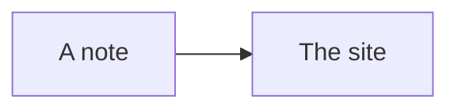

{/*
  docs/examples.mdx: one page that holds every admonition keyword and each shared piece, so a look at it
  proves the site's wiring, in both themes. __tests__/site.test.mjs reads it.
  How to change it: copy what you need from here. A new shared piece or keyword gets a line here.
*/}

import Asterisk from '@site/src/components/Asterisk';
import BibRef from '@site/src/components/BibRef';
import DropDownIC from '@site/src/components/DropDownIC';
import LC from '@site/src/components/LC';

## Admonitions

Thirteen keywords, each opened with three colons.

:::danger

The `danger` box.

:::

:::warning

The `warning` box.

:::

:::caution

The `caution` box.

:::

:::info

The `info` box.

:::

:::tip

The `tip` box.

:::

:::note

The `note` box.

:::

:::dwf

The `dwf` box.

:::

:::key

The `key` box.

:::

:::perf

The `perf` box.

:::

:::extension

The `extension` box.

:::

:::study

The `study` box.

:::

:::tool

The `tool` box.

:::

:::iio

The `iio` box.

:::

## Pieces

An aside in a tooltip<Asterisk>The words of the aside.</Asterisk> sits inside a sentence.

A citation shows its source in a tooltip and links to the reference list <BibRef id="example-book" pages="p. 4" />.

A problem link reads <LC id="1" /> or <LC id="1" type="long" />.

An inline dropdown opens in the middle of a sentence: the <DropDownIC title="modulus operator ($\%$)">remainder after dividing</DropDownIC>, and the sentence carries on below it.

## Maths

Maths works inline, as $\R^2$, and on a line of its own, with the macros every site shares:

$$
\sum_{k=1}^{n} k = \frac{n(n+1)}{2}, \quad n \in \N
$$

## Code

Magic comments mark a line:

```js title="marked.js"
const kept = 1;
// highlight-next-line
const highlighted = 2;
// highlight-error-next-line
const wrong = 3;
// highlight-success-next-line
const right = 4;
// highlight-warning-next-line
const careful = 5;
// highlight-add-next-line
const added = 6;
// highlight-remove-next-line
const removed = 7;
```

## Diagram


